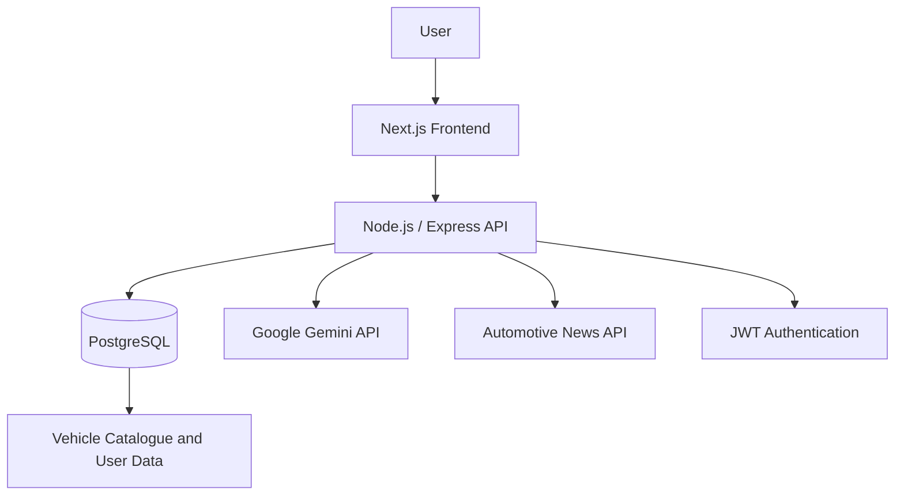

# RideMatch AI 🚗
### AI-Powered Vehicle Discovery & Recommendation Platform

RideMatch AI is a full-stack vehicle discovery platform that helps users explore vehicles, filter options, compare specifications, and receive AI-assisted recommendations based on their preferences and budget.

The project combines a Next.js frontend, Node.js/Express backend, PostgreSQL database, and Google Gemini integration. It also includes containerization, CI/CD workflows, AWS deployment configuration, and infrastructure-as-code.

**Repository:** https://github.com/Ashwin1808/ridematch-ai

---

## Overview

Finding a vehicle that matches a specific budget and set of requirements can involve comparing multiple websites and specifications. RideMatch AI brings vehicle discovery, filtering, comparison, and recommendation workflows into one application.

### Key capabilities

- Vehicle discovery and filtering
- AI-assisted vehicle recommendations
- Vehicle comparison
- User authentication using JWT
- Favorites
- Automotive news integration
- Fuel cost calculator
- Dashboard statistics
- PostgreSQL-backed vehicle catalogue

## Architecture



## Technology stack

| Layer | Technologies |
|---|---|
| Frontend | Next.js, React, JavaScript |
| Backend | Node.js, Express.js |
| Database | PostgreSQL 16 |
| AI | Google Gemini API |
| Authentication | JWT |
| Containers | Docker, Docker Compose |
| CI/CD | GitHub Actions |
| Cloud / Infrastructure | AWS, Terraform |
| Container scanning | Trivy |
| Code quality | SonarCloud |
| Orchestration configuration | Kubernetes, Helm |

## AI recommendation workflow

The recommendation engine combines database filtering with deterministic scoring and AI-assisted explanations.

1. The user submits preferences such as budget, fuel type, transmission, body type, and seating capacity.
2. The backend filters eligible vehicles using SQL.
3. A deterministic scoring mechanism ranks candidates:
   - Budget: 40 points
   - Fuel type: 20 points
   - Transmission: 15 points
   - Body type: 15 points
   - Seating capacity: 10 points
4. Gemini is used to explain or re-rank candidate vehicle IDs.
5. If the AI response is invalid, the application falls back to deterministic recommendations.

This hybrid approach keeps candidate selection grounded in the vehicle database while using AI to improve the recommendation experience.

## Application features

### Vehicle discovery
Browse the available vehicle catalogue and narrow results using filters.

### AI recommendations
Generate recommendations from user preferences using database filtering, scoring, and Gemini-assisted explanations.

### Vehicle comparison
Compare vehicle specifications using the application's deterministic comparison scoring.

### Authentication and favorites
JWT-based authentication and favorite vehicle functionality.

### Automotive news
Retrieve automotive news through the configured news API integration.

### Fuel calculator
Estimate fuel expenses using configured fuel-price values. These values are not represented as a live fuel-price feed.

## DevOps and deployment

The repository includes DevOps implementation and infrastructure configuration alongside the application.

### Docker

- Multi-stage backend Docker build.
- Multi-stage frontend Docker build using the Next.js standalone output.
- Docker Compose configuration for the application services and PostgreSQL.
- Containerized local development and deployment workflow.

### CI/CD with GitHub Actions

The configured workflow includes:

- Backend and frontend build steps.
- Terraform formatting and validation.
- Docker image builds.
- Trivy container image scanning.
- Image publishing.
- SonarCloud analysis.
- Deployment workflow for an EC2 host using Docker Compose.

The workflow configuration is present in the repository. Automated application test coverage is not currently implemented, and the configured Trivy scan does not currently fail the pipeline on findings.

### AWS and Terraform

Terraform configuration is included for AWS infrastructure components such as:

- VPC and subnet architecture.
- Internet Gateway and NAT Gateway.
- Security groups.
- Application Load Balancer.
- EC2 launch template and Auto Scaling Group.
- IAM configuration.
- CloudWatch configuration.

**Deployment status:** EC2 and Docker Compose deployment work has been practiced. The Terraform configuration is documented as infrastructure code and has validation evidence; a current, verified Terraform-managed production deployment is not claimed.

### Kubernetes and Helm

Kubernetes manifests and a Helm chart are included as orchestration configuration and learning/implementation work. The chart has outstanding issues and is not currently claimed as an installable, verified deployment.

### Monitoring

The repository contains monitoring-related configuration, including Prometheus metrics and monitoring stack configuration. A complete deployed Prometheus/Grafana/Loki/Alertmanager environment is not claimed.

## Repository structure

```text
ridematch-ai/
├── backend/
├── frontend/
├── db/
├── etl/
├── docs/
├── terraform/
├── k8s/
├── ridematch-chart/
├── monitoring/
├── .github/
│   └── workflows/
├── docker-compose.yml
└── README.md
```

## Local development

### Prerequisites

- Node.js
- npm
- Docker Desktop or Docker Engine
- Docker Compose
- PostgreSQL, if running services outside Compose

### Environment configuration

Create the environment files required by the frontend and backend. Use the environment variable names referenced in the respective application configuration.

Typical configuration categories include:

```env
DATABASE_URL=
JWT_SECRET=
GEMINI_API_KEY=
GNEWS_API_KEY=
```

Do not commit real credentials or production secrets.

### Run with Docker Compose

From the repository root:

```bash
docker compose up --build
```

Check the Compose configuration and required environment variables before starting the services.

### Application endpoints

| Component | Local endpoint |
|---|---|
| Frontend | http://localhost:3000 |
| Backend | http://localhost:5001 |
| PostgreSQL | localhost:5432 |

## Engineering decisions

- **SQL filtering before AI:** Candidate selection starts with database-backed filtering rather than asking an LLM to invent vehicle results.
- **Deterministic fallback:** Recommendations remain available when the AI response is invalid.
- **Containerized services:** Docker provides a consistent application environment.
- **CI/CD automation:** Build, image scanning, publishing, and deployment steps are represented in GitHub Actions.
- **Infrastructure as code:** Terraform captures the intended AWS infrastructure architecture.

## Current limitations and future improvements

- Add automated backend and frontend tests.
- Improve secret management and remove remaining hardcoded credentials from sample/configuration files.
- Complete and validate the Kubernetes Helm deployment.
- Deploy and verify the monitoring stack end to end.
- Improve per-user data isolation for favorites.
- Connect fuel pricing to a verified live data provider.
- Add stronger CI security gates and deployment verification.
- Add screenshots and recorded deployment evidence.

## Project focus

RideMatch AI demonstrates full-stack application development combined with practical DevOps implementation: containerization, CI/CD configuration, cloud infrastructure design, deployment workflows, and operational troubleshooting.

---

**Note:** This repository contains a mix of implemented application functionality, tested DevOps workflows, and infrastructure/orchestration configurations at different levels of completion. The documentation distinguishes these rather than presenting every configuration as a live deployment.
