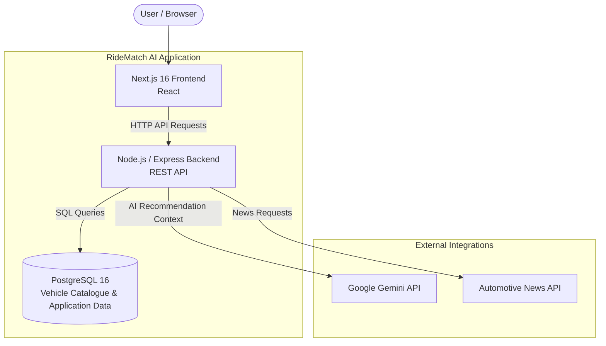
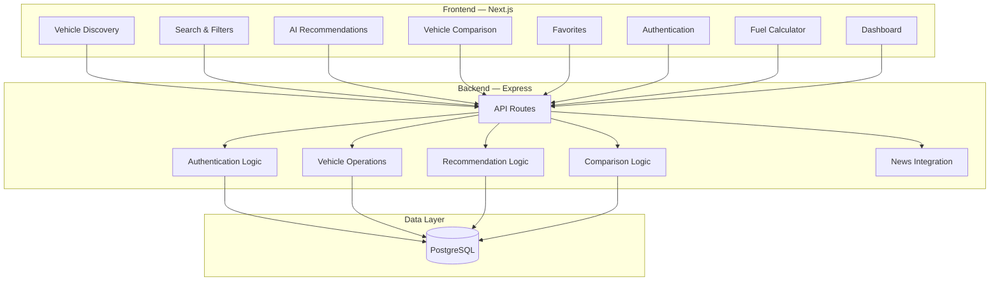
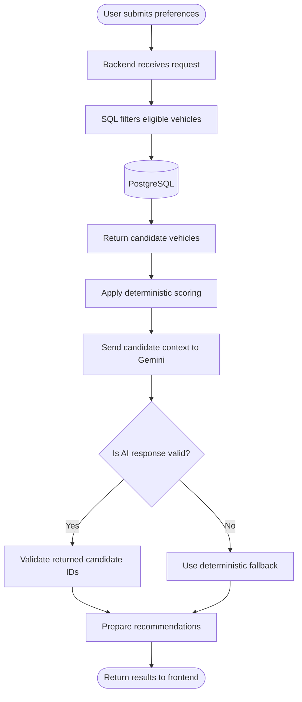
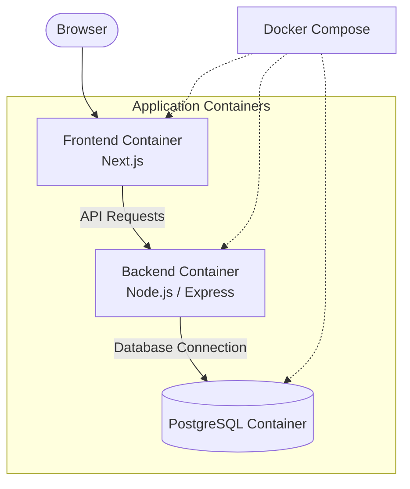
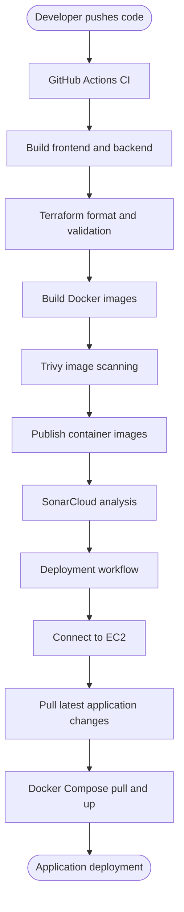
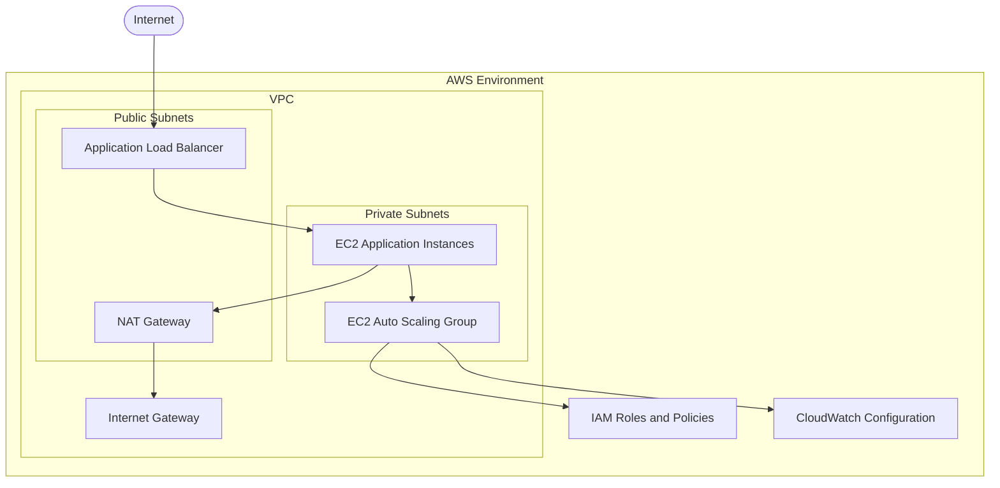
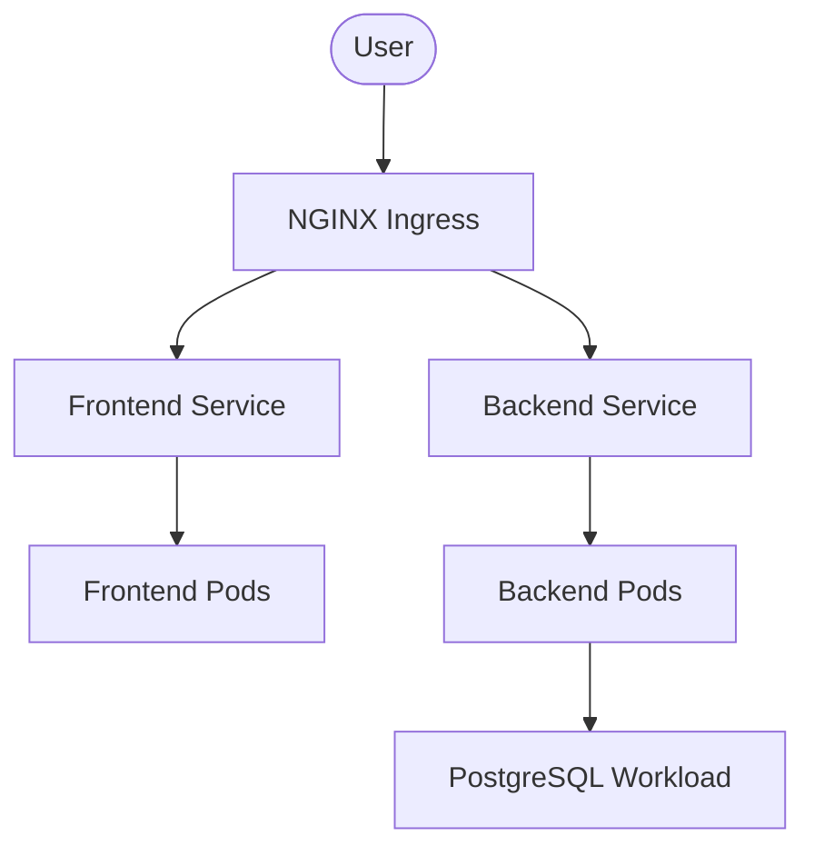
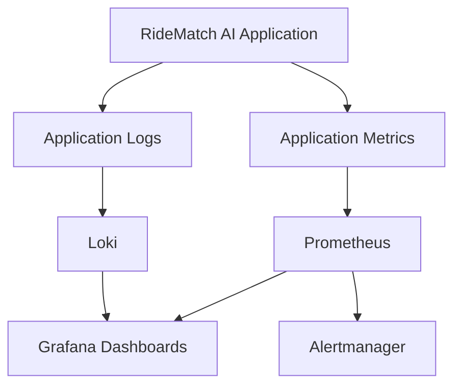

# RideMatch AI — Architecture & Engineering Documentation

## 1. System Overview

RideMatch AI is a full-stack vehicle discovery and recommendation platform built using Next.js, Node.js, Express, PostgreSQL, and Google Gemini.

The application separates the presentation layer, backend business logic, persistent data, and external integrations.

## 2. High-Level System Architecture

## 3. Application Component Architecture

## 4. AI Recommendation Workflow

The recommendation engine uses database filtering, deterministic scoring, and Gemini-assisted explanations or candidate re-ranking.

### Recommendation scoring model

| Preference | Weight |
|---|---:|
| Budget | 40 |
| Fuel type | 20 |
| Transmission | 15 |
| Body type | 15 |
| Seating capacity | 10 |
| **Total** | **100** |

The backend filters candidates before AI processing. Gemini does not independently create vehicle records.

## 5. Container Architecture

The application uses Docker to package the frontend and backend. Docker Compose coordinates the application containers and PostgreSQL.

## 6. CI/CD Pipeline

The repository contains GitHub Actions workflows for building, validating, scanning, publishing images, and deploying to an EC2 host.

**Important:** This diagram represents the configured workflow. It does not imply automated application tests or independently verified production deployment.

## 7. AWS Infrastructure Architecture

Terraform configuration describes the intended AWS infrastructure.

**Implementation status:** Terraform source configuration is present and has validation evidence. This diagram describes the intended architecture, not a currently verified Terraform-managed production environment.

## 8. Kubernetes Architecture — Planned / Under Development

The repository contains Kubernetes manifests and Helm templates. The chart has outstanding issues and is not currently claimed as a verified, installable deployment.

This is a conceptual target architecture, not a representation of a verified running Kubernetes cluster.

## 9. Observability Architecture — Planned / Under Development

The repository includes monitoring-related configuration, but the complete monitoring stack has not been verified as deployed.

## 10. Technology Stack

| Layer | Technology |
|---|---|
| Frontend | Next.js 16, React |
| Backend | Node.js, Express |
| Database | PostgreSQL 16 |
| AI integration | Google Gemini |
| Authentication | JWT |
| Containers | Docker, Docker Compose |
| CI/CD | GitHub Actions |
| Cloud | AWS |
| Infrastructure as Code | Terraform |
| Image scanning | Trivy |
| Code quality | SonarCloud |
| Orchestration configuration | Kubernetes, Helm |
| Monitoring configuration | Prometheus, Grafana, Loki, Alertmanager |

## 11. Engineering Improvements

- Implement automated backend and frontend tests.
- Strengthen CI security gates.
- Improve deployment verification and rollback.
- Complete Kubernetes and Helm validation.
- Deploy monitoring components end to end.
- Improve user-specific data isolation.
- Integrate a verified live fuel-price provider.
- Improve application observability and operational alerts.

## 12. Documentation Status

This document distinguishes between implemented application functionality, tested workflows, infrastructure configuration, and planned or incomplete deployment components.

The presence of a configuration file alone does not establish that a service is deployed or operational.
