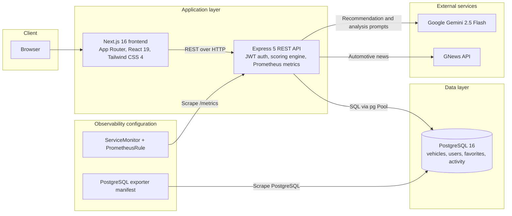
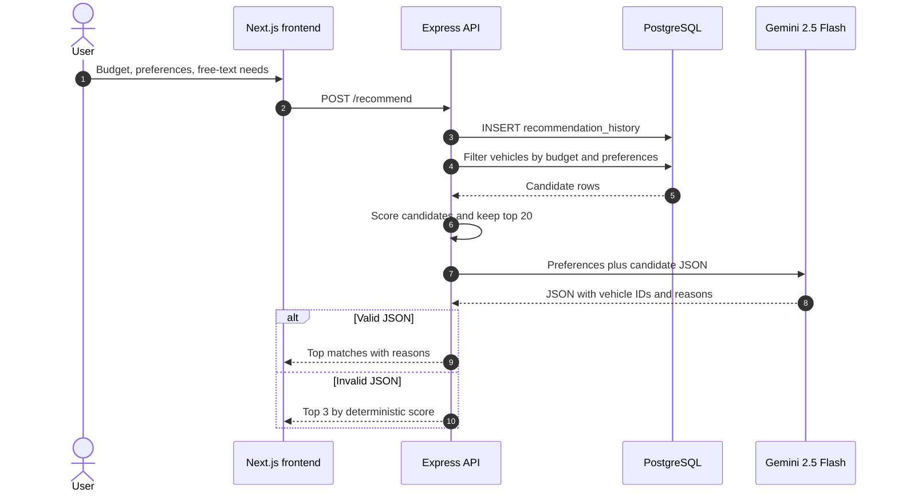
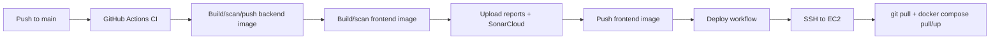

# Building RideMatch AI: From SQL Filters to Gemini-Powered Vehicle Recommendations

**Subtitle:** A full-stack case study covering the product, the recommendation pipeline, and the DevOps setup behind an AI-powered vehicle discovery platform.

**Tags:** `nextjs`, `ai`, `postgresql`, `devops`

**Canonical repository:** https://github.com/Ashwin1808/ridematch-ai

---

## Introduction

Vehicle buying is a research-heavy decision disguised as a simple purchase. A buyer has to compare prices, mileage, safety ratings, fuel types, seating, maintenance cost, and long-term suitability, usually across a dozen tabs and spreadsheets.

RideMatch AI turns that into one flow: describe what you need, get a ranked shortlist, read why each vehicle fits, compare the finalists, and estimate running costs.

Under the hood, it is a full-stack system with a Next.js frontend, an Express API, PostgreSQL, Google Gemini, a Python ETL pipeline, Docker, GitHub Actions, Terraform AWS definitions, Kubernetes/Helm manifests, and Prometheus monitoring configuration. This article walks through the important parts and the design decisions that made the project feel like a product rather than a demo.

---

## The problem with "AI recommends a car"

The naive version of this idea is straightforward: send a user prompt to an LLM and render the response.

That approach has three problems:

1. **Hallucination.** The model can recommend a vehicle that does not exist, at a price that does not exist.
2. **Inconsistency.** The same prompt can produce different shortlists on different runs.
3. **No data integrity.** There is no reliable link between a recommendation and a database row the user can open.

RideMatch AI uses a different split of responsibilities:

- SQL handles hard constraints such as budget and body type.
- A deterministic scoring model ranks the remaining candidates.
- Gemini explains the shortlist in natural language.

The model is an explainer and re-ranker, not the source of truth.

---

## What the product does

The main user journey looks like this:

1. On the home page, the user enters a budget, vehicle type, fuel, transmission, body type, seating requirement, usage pattern, mileage/safety priorities, and an optional free-text description.
2. The backend filters the PostgreSQL catalogue, scores the candidates, and sends the top 20 to Gemini.
3. The user receives ranked vehicle cards with AI-written reasons.
4. The user can open a detail page, save a favorite, or compare up to five vehicles.
5. The detail page adds an AI summary, pros and cons, reviews, similar vehicles, and a fuel-cost calculator.

The catalogue is seeded with **1,284 vehicles** across **40 distinct makes**, with 1,280 cars and 4 bikes. Of those, **1,276** rows were imported through the ETL pipeline and **8** are curated seed vehicles; the `brand` column is unpopulated, so the UI treats `make` as the brand. The richer imported rows include engine displacement, cylinders, power, torque, dimensions, and fuel tank capacity.

Other product surfaces include JWT-based registration and login, a dashboard of activity counts and trending vehicles, automotive news from GNews, and configured fuel-price values used by the calculator. The comparison count is seeded because the active comparison route does not write history.

---

## Architecture at a glance



The frontend is a client-rendered Next.js application. The backend is a single Express service with route handlers grouped around vehicles, AI, favorites, authentication, news, dashboard data, and operations endpoints. PostgreSQL stores both the catalogue and lightweight activity data. Gemini and GNews are the only external services that matter at request time.

> If your publishing platform does not render Mermaid, paste the diagram block into mermaid.live and export it as an image.

---

## The data layer

The database schema is intentionally small:

| Table | Purpose |
| --- | --- |
| `vehicles` | Catalogue with pricing, mileage, safety, fuel, transmission, body, dimensions, engine, and image fields |
| `users` | Registered accounts with bcrypt-hashed passwords |
| `favorites` | Saved vehicle IDs |
| `vehicle_views` | View events used to compute trending vehicles |
| `vehicle_reviews` | Source, rating, and review text |
| `recommendation_history` | Budget, vehicle type, and usage type for each recommendation request |
| `comparison_history` | Compared vehicle names and timestamps |

The schema and seed data live in `db/init.sql`. The file is mounted into the PostgreSQL container and runs automatically the first time the data volume is created.

One useful product detail is that `GET /vehicle/:id` writes a row to `vehicle_views`. The dashboard then aggregates those rows to surface the four most-viewed vehicles. It is a small feature, but it makes the home page feel alive and gives the project real activity data to display.

The ETL pipeline lives in `etl/`. It uses pandas and psycopg2 to read `shrey_car_dataset.csv`, clean prices, infer usage type from body type, and insert the vehicle rows. Separate scripts enrich vehicle image URLs.

---

## The recommendation pipeline

This is the core of the project.



### Stage 1: Filter in SQL

The API builds a parameterized query. Budget is always applied. The optional filters are vehicle type, fuel type, transmission, body type, and minimum seating capacity.

```sql
SELECT *
FROM vehicles
WHERE budget <= $1
  AND LOWER(type) = LOWER($2)
  AND LOWER(fuel_type) = LOWER($3)
LIMIT 30;
```

Parameterized queries keep user input out of the SQL string, and the query is deliberately capped before the scoring stage.

### Stage 2: Score deterministically

Each candidate receives a score out of 100:

| Criterion | Points | Rule |
| --- | --- | --- |
| Budget fit | 40 | Vehicle budget is within the requested budget |
| Fuel type | 20 | Exact case-insensitive match |
| Transmission | 15 | Vehicle transmission contains the requested value |
| Body type | 15 | Exact case-insensitive match |
| Seating | 10 | Vehicle seating capacity meets or exceeds the request |

The API sorts by score, keeps the top 20, and passes those rows to Gemini along with the user's preferences and free-text prompt.

### Stage 3: Let Gemini explain, not invent

The prompt instructs the model to return only valid JSON:

```json
{
  "recommendations": [
    { "id": 2, "reason": "Why this vehicle fits the buyer." }
  ]
}
```

The API then maps the returned IDs back to rows it already fetched from PostgreSQL. If the model returns an ID that is not in the candidate list, that recommendation is discarded. If the response cannot be parsed, the API returns the top three rows from the deterministic score.

That fallback path is the most important reliability decision in the project. AI features often fail in boring ways: a timeout, a markdown fence around the JSON, a malformed field, or a rate limit. A good product should still answer the user's question when that happens.

---

## Comparing vehicles

The comparison page accepts up to five vehicle IDs from the frontend's compare tray. The API loads the selected rows and computes:

```text
score = (safety * 5) + mileage + max(0, 20 - budget)
```

The highest score becomes the winner. The response includes a winner name, a verdict, a list of pros, and a list of cons. The frontend renders a comparison table with price, mileage, safety, fuel, transmission, body type, and seating.

The current comparison route uses this deterministic model rather than a live LLM call. That keeps comparisons fast and stable. A Gemini comparison helper exists in the codebase, but it is not wired into the active route. This is a useful reminder that not every feature labelled "AI" needs a model call at request time; sometimes a transparent scoring function is the better product choice.

---

## AI vehicle analysis and automotive news

Vehicle detail pages call `POST /vehicle-ai`. Gemini receives the vehicle record and is asked for a structured response:

- a two-sentence summary,
- three pros,
- two cons,
- an ideal-buyer sentence,
- a one-sentence verdict.

The backend strips markdown fences, extracts the JSON object, and falls back to safe empty fields if parsing fails. The detail page also renders seeded reviews and similar vehicles based on body type, fuel type, or a budget within three lakhs.

The news feed is powered by GNews. The API filters headlines for buying-relevant topics such as launch, facelift, hybrid, electric, battery, price, variant, features, engine, and mileage, while skipping accident, crash, killed, and fire headlines.

---

## Authentication

Registration hashes passwords with bcrypt before storing them. Login compares the submitted password with the stored hash and issues a JWT with a seven-day expiry. The token contains the user ID and email, and `/profile` verifies the bearer token before returning the user record.

This is a deliberately small auth surface. It demonstrates the important mechanics without pretending to be a complete identity platform. Refresh tokens, logout/revocation, password reset, and per-user data ownership are good next steps.

---

## The frontend

The frontend uses Next.js 16 with the App Router, React 19, TypeScript, and Tailwind CSS 4. It is primarily a client-rendered application because most screens depend on the API and local browser state.

A few implementation details worth calling out:

- The compare tray is managed by a React context and persisted to `localStorage`, so selections survive navigation.
- Recently viewed vehicles are stored locally on the vehicle detail page.
- The results page reads recommendation data from `localStorage` after the home page receives it from the API.
- The frontend build is a standalone Next.js output, which keeps the production Docker image small.
- `NEXT_PUBLIC_API_URL` is embedded at build time, so changing the backend URL requires rebuilding the frontend image.

The visual design uses a dark editorial theme with cobalt accents, glass panels, and motion. It is intentionally more "product" than "admin dashboard".

---

## Delivery and operations

A project like this is a good excuse to practice the full delivery path, not just application code.

### Containers

Both services use multi-stage Docker builds:

- The backend installs production dependencies, copies the runtime code, creates a non-root user, and adds a health check against `/health`.
- The frontend builds the Next.js standalone output, copies only the production artifacts, and runs as a non-root user.

### CI/CD



The CI workflow installs dependencies, builds both applications, validates the Terraform configuration without applying it, builds and scans the Docker images, uploads the Trivy and Sonar artifacts, and pushes tagged images to Docker Hub. The backend image is pushed before the frontend build; the workflow does not run automated tests.

The deployment workflow runs after a successful CI run, connects to the EC2 host over SSH, writes the runtime environment files from GitHub Actions secrets, pulls the latest images, and restarts the Compose stack. The database URL and PostgreSQL password are supplied as secrets rather than embedded in the workflow, and no workflow run evidence is committed.

### Terraform on AWS

The Terraform modules define:

- a VPC with two public and two private subnets across two availability zones,
- an internet gateway and NAT gateway,
- ALB and backend security groups,
- an Application Load Balancer with a `/health` target group,
- an EC2 launch template that installs Docker and Docker Compose,
- an Auto Scaling Group attached to the target group,
- an IAM instance profile,
- a CloudWatch CPU alarm and scale-up policy.

Workspaces select `dev`, `qa`, or `prod` configurations with different instance sizes and instance counts. The configuration is source-only here: CI validates it but never applies it, the ignored local state files in this checkout contained zero resources when inspected, and no current AWS deployment is verified. The remote S3 state must be checked separately.

### Kubernetes and Helm

The Helm chart defines templates for:

- a backend Deployment with startup, liveness, and readiness probes,
- a Horizontal Pod Autoscaler from 3 to 10 replicas at 50% CPU,
- a NetworkPolicy that only allows the backend to reach PostgreSQL,
- ServiceAccount, Role, and RoleBinding,
- ServiceMonitors for the backend and PostgreSQL exporter,
- an NGINX Ingress.

The chart also contains PostgreSQL StatefulSet, Service, and PVC templates, but they are currently commented out. For a self-managed database, use the raw manifests in `k8s/postgres/` or enable those templates. The backend reads its connection string from `DATABASE_URL`, but the committed chart does not wire that value. The chart is not turnkey: `templates/loki-values.yaml` is not a valid manifest, `templates/secret.yaml` hardcodes empty values, the PostgreSQL exporter references a missing Secret, and the backend ServiceMonitor selector does not match the Service.

### Monitoring

The backend uses `prom-client` to expose request counts and latency histograms at `/metrics`. A ServiceMonitor template configures scraping, but its selector does not currently match the backend Service. The repository also includes a PostgreSQL exporter manifest, alert rules for backend downtime, database downtime, high CPU, and high memory, and misplaced Loki values. The exporter cannot start without its missing Secret. Grafana, Loki, and Alertmanager are not deployed by the repository.

The AlertmanagerConfig references a Gmail SMTP receiver and an external `alertmanager-gmail-secret`; no Alertmanager Deployment or Secret is included.

---

## Challenges and lessons

### 1. AI output is not an API contract

The model is useful, but it is not a reliable data source. The system works because the database owns the candidate list and the model only supplies a ranking and explanation. Every AI response path needs a deterministic fallback.

### 2. Build-time versus runtime configuration matters

`NEXT_PUBLIC_API_URL` is baked into the frontend bundle. That is convenient for a static standalone build, but it means the API URL is a deployment concern, not a runtime toggle. The CI pipeline passes it as a Docker build argument for exactly that reason.

### 3. Local Compose and production Compose have different context

The backend expects `DATABASE_URL` to point at the `postgres` service inside the Compose network. From the host, the same database is on `localhost`. Small environment differences like this cause most "it works on my machine" failures.

### 4. DevOps features are product features

Health checks, probes, metrics, and alerts are not decoration. A recommendation API that is running but cannot reach PostgreSQL should fail its readiness probe instead of serving broken responses.

### 5. The best AI feature is sometimes not an AI call

The comparison engine uses a transparent score. It is faster, cheaper, and easier to explain than a model call, while still giving the user a clear winner. Use the model where language generation or nuanced explanation adds value.

---

## What I would build next

- Per-user favorites, recommendation history, and comparison history.
- Automated tests with coverage gates, especially around the scoring and fallback paths.
- An OpenAPI specification and generated frontend client types.
- A live fuel-price provider with caching.
- Refresh tokens, logout/revocation, and password reset.
- Rate limiting and request validation on auth and AI routes.
- A provider abstraction for AI calls so Gemini can be swapped or load-balanced.
- Helm and manifest validation in CI.
- A production-ready frontend Kubernetes deployment and TLS ingress.
- A LICENSE file for open-source distribution.

---

## Conclusion

RideMatch AI started as a vehicle recommendation idea and became a full-stack exercise in data modelling, AI reliability, frontend product design, and cloud delivery.

The most useful takeaway is the architecture pattern: keep deterministic systems in control of facts, use the LLM to explain and rank, and design the fallback before the happy path. That pattern applies far beyond cars.

The full source is available here: **https://github.com/Ashwin1808/ridematch-ai**

If you are building something similar, or if you have feedback on the recommendation pipeline or the deployment setup, I would be glad to hear it.
